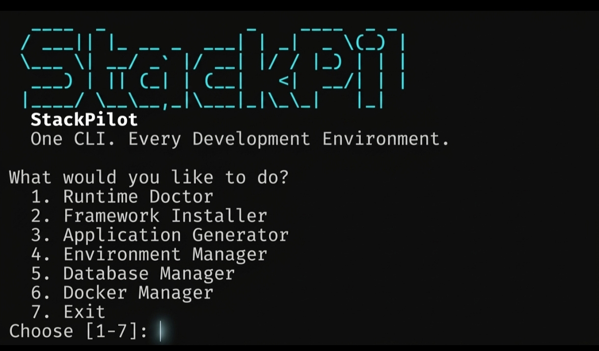

<div align="center">
  
  <h1>StackPilot</h1>
  <p><strong>One CLI. Every Development Environment.</strong></p>
  <p><strong>Toolkit developer open-source untuk memeriksa environment, menyiapkan framework, dan membuat starter aplikasi full-stack melalui satu CLI interaktif.</strong></p>
  <p><a href="https://github.com/Bagaas-ind/StackPilot/actions/workflows/ci.yml"></a> <a href="https://github.com/Bagaas-ind/StackPilot/stargazers"></a> <a href="https://github.com/Bagaas-ind/StackPilot/network/members"></a>  </p>
  <p><a href="README.md">English</a> · <strong>Bahasa Indonesia</strong></p>
</div>

<p align="center">
  
</p>

---

> **Informasi distribusi:** Nama package npm sudah dikonfigurasi di project, tetapi package belum dipublikasikan ke npm registry. Sampai rilis npm diumumkan, gunakan perintah GitHub di atas.

## Dibuat untuk workflow development sehari-hari

- **Periksa** runtime dan tools development yang tersedia di komputer.
- **Siapkan** framework populer melalui workflow instalasi terpandu.
- **Buat** aplikasi Laravel 12 API + React/Vite beserta konfigurasi database.
- **Kelola** informasi environment, client database, dan workflow Docker Compose dari satu menu.

## Apa itu StackPilot?

StackPilot menyatukan kebutuhan setup development yang umum ke dalam satu command-line interface interaktif. Kamu bisa memeriksa runtime lokal, menjalankan workflow setup framework, dan membuat starter aplikasi Laravel API + React.

StackPilot adalah utilitas development lokal. StackPilot bukan pengganti tools resmi dari masing-masing framework, database, atau platform container.

## Alur penggunaan terminal

Jalankan StackPilot tanpa argumen untuk membuka menu interaktif. Pilih fitur, selesaikan workflow, lalu kembali ke menu utama. Pilih **Exit** untuk menutup StackPilot.

```text
  ____  _             _    ____  _ _
 / ___|| |_ __ _  ___| | _|  _ \\(_) |
 \\___ \\| __/ _` |/ __| |/ / |_) | | |
  ___) | || (_| | (__|   <|  __/| | |
 |____/ \\__\\__,_|\\___|_|\\_\\_|   |_|

  StackPilot
  One CLI. Every Development Environment.

  1. Runtime Doctor
  2. Framework Installer
  3. Application Generator
  4. Environment Manager
  5. Database Manager
  6. Docker Manager
  7. Exit
```

Menu utama membutuhkan terminal interaktif (TTY). Perintah manager di bawah ini juga dapat dijalankan langsung tanpa membuka menu.

## Fitur StackPilot

### Runtime Doctor

Memeriksa ketersediaan dan menampilkan versi tools berikut:

- Node.js dan npm — wajib untuk menjalankan StackPilot.
- PHP dan Composer.
- Python.
- Java.
- Git.
- Docker.

StackPilot mendukung Node.js 22 dan 24. Tools lainnya bersifat opsional untuk CLI dan hanya dibutuhkan oleh workflow yang menggunakannya. Doctor hanya melakukan diagnostik; tidak memasang, memperbarui, atau menghapus software.

### Environment Manager

Menampilkan inventaris runtime Node.js, npm, PHP, Composer, Python, Python 3, Java, Git, dan Docker, serta maksimal 12 entri PATH. Fitur ini read-only: tidak mengubah PATH dan tidak memasang/menghapus tools. Executable opsional yang tidak terdeteksi belum tentu berarti service terkait tidak tersedia.

### Database Manager

Memeriksa ketersediaan client command-line database berikut:

- MySQL: `mysql`
- MariaDB: `mariadb`
- PostgreSQL: `psql`
- SQLite: `sqlite3`
- MongoDB Shell: `mongosh`
- Redis: `redis-cli`

Manager juga melakukan pemeriksaan keterjangkauan TCP read-only pada port server lokal yang umum: MySQL/MariaDB (3306 dan 3307), PostgreSQL (5432), MongoDB (27017), dan Redis (6379). Secara default StackPilot memeriksa `127.0.0.1`; gunakan `STACKPILOT_DB_HOST` untuk memeriksa host lain. Setiap probe TCP memiliki batas waktu 700 ms. SQLite berbasis file sehingga tidak membutuhkan port server.

Status **TCP OPEN** hanya berarti port menerima koneksi TCP. Status ini tidak memverifikasi protokol database, kredensial, izin, atau kesehatan query. MySQL dan MariaDB menggunakan port/protokol yang kompatibel sehingga tidak dapat dibedakan melalui pemeriksaan ini. Deteksi client dan keterjangkauan server ditampilkan terpisah; client yang tidak ditemukan bukan berarti server database tidak tersedia. Jika Docker CLI tersedia, Docker Compose juga diperiksa.

Manager ini bersifat read-only: tidak mengirim kredensial atau query SQL, serta tidak membuat, menghapus, atau mengubah database.

### Docker Manager

Memeriksa Docker CLI, koneksi daemon, dan Docker Compose. Jika daemon dapat diakses, StackPilot menampilkan container yang sedang berjalan dan menyediakan pilihan:

1. Menampilkan semua container.
2. Menampilkan image lokal.
3. Menjalankan project Compose di direktori aktif.
4. Menghentikan project Compose di direktori aktif.
5. Kembali ke menu utama.

Aksi Compose up/down memerlukan plugin Compose, file konfigurasi yang didukung di direktori aktif (`compose.yaml`, `compose.yml`, `docker-compose.yml`, atau `docker-compose.yaml`), serta konfirmasi eksplisit. Perintah yang dijalankan adalah `docker compose up -d` dan `docker compose down`. Periksa file Compose dan dampaknya sebelum memberi konfirmasi.

### Framework Installer

Menyediakan workflow setup interaktif untuk 11 framework:

| Ekosistem | Framework | Kebutuhan utama |
| --- | --- | --- |
| PHP | Laravel, CodeIgniter 4, Symfony | PHP dan Composer |
| JavaScript | React, Vue.js, Next.js, Express.js | Node.js dan npm |
| Python | Django, Flask, FastAPI | Python dan pip |
| Java | Spring Boot | Java dan `tar` |

Installer memvalidasi nama project, memeriksa tools yang diperlukan, lalu menjalankan perintah setup atau workflow starter yang sesuai. Project Python dibuat di virtual environment lokal `.venv`; Spring Boot diunduh dari Spring Initializr. Proses setup framework dapat mengunduh package dan dependency sehingga umumnya membutuhkan koneksi internet. Setup Spring Boot saat ini meminta Java 17 dari Spring Initializr.

### Application Generator

Membuat starter Laravel API + React SPA dengan fitur:

- Backend Laravel 12 dan autentikasi API Sanctum.
- Frontend React + Vite dengan pilihan JavaScript atau TypeScript.
- Konfigurasi database SQLite, MySQL, atau PostgreSQL.
- Pilihan template starter atau ecommerce.
- Pembuatan frontend saja melalui `--skip-backend`.
- Opsi melewati instalasi dependency frontend melalui `--skip-install`.
- Script startup Windows dan Unix jika backend dibuat.

Secara default, generator membuat backend dan frontend. PHP 8.2+ dan Composer 2.x diperlukan kecuali menggunakan `--skip-backend`. Node.js dan npm tetap diperlukan. Saat backend dibuat, generator menjalankan workflow Composer/Laravel dan dapat menjalankan `npm install` untuk frontend.

Project hasil generate adalah fondasi development, bukan sertifikasi keamanan production. Tinjau autentikasi, otorisasi, CORS, secret environment, konfigurasi database, dependency, dan keamanan deployment sebelum digunakan di production.

## Persyaratan

- Launcher Windows menyediakan Node.js 22 LTS portable secara otomatis. Jika menjalankan StackPilot langsung melalui `npx` atau hasil clone, gunakan Node.js 22 atau 24 LTS dan npm.
- Tools framework hanya diperlukan sesuai fitur yang dipilih.
- PHP 8.2+ dan Composer 2.x untuk membuat backend Application Generator.
- Python dan pip untuk starter framework Python.
- Java dan `tar` untuk Framework Installer Spring Boot.
- Docker Engine/Desktop dan plugin Compose untuk aksi Docker Manager.
- Koneksi internet untuk mengunduh framework dan memasang dependency.

## Panduan untuk pemula dan penggunaan

Baru mengenal GitHub atau terminal? Mulai dari [Panduan Pemula](docs/BEGINNER_GUIDE.id.md), lalu lanjutkan ke [Panduan Penggunaan](docs/USAGE.id.md) untuk petunjuk CMD, PowerShell, Node.js, troubleshooting, dan perintah terminal.

## Instalasi dan penggunaan

### Windows 10/11 — satu perintah dari CMD (tanpa Node.js terpasang)

**CMD (Command Prompt) adalah cara yang direkomendasikan untuk pengguna Windows pemula.** Buka CMD biasa (tidak perlu Administrator), lalu salin satu baris ini:

```cmd
powershell.exe -NoLogo -NoProfile -Command "irm 'https://raw.githubusercontent.com/Bagaas-ind/StackPilot/main/scripts/install.ps1' | iex"
```

Perintah ini diketik di CMD. PowerShell hanya dijalankan di belakang layar untuk menjalankan launcher; pengguna tidak perlu membuka PowerShell atau memasang Node.js/npm/Git terlebih dahulu. Perintah yang sama juga dapat dijalankan dari terminal VS Code, baik profil CMD maupun PowerShell.

Launcher mendukung Windows 10/11 x64 (Intel/AMD 64-bit), membutuhkan koneksi internet, dan tidak memerlukan hak Administrator. Launcher mengunduh runtime Node.js 22 LTS portable ke `%LOCALAPPDATA%\\StackPilot\\runtime` dan memverifikasi arsipnya menggunakan SHA-256 dari server resmi Node.js. Setelah itu launcher mengunduh source ZIP StackPilot langsung dari GitHub (tidak membutuhkan Git), memasang dependency yang tercatat di `package-lock.json`, lalu menjalankan CLI. Runtime hanya disimpan untuk akun Windows saat ini; launcher tidak mengubah PATH sistem dan tidak memasang Node.js secara global. Logo ASCII dan seluruh menu/fitur StackPilot tetap digunakan. File sementara dibersihkan setelah aplikasi ditutup.

**Catatan keamanan dan kompatibilitas:** perintah ini mengambil lalu menjalankan launcher dari repository StackPilot. Jalankan hanya jika mempercayai repository dan telah meninjau script `scripts/install.ps1`; kamu juga bisa mengunduh dan memeriksa script tersebut sebelum menjalankannya. Tidak ada perintah yang dapat menjamin keamanan mutlak. Launcher saat ini hanya mendukung Windows x64, bukan ARM64/32-bit. Ini menghilangkan instalasi Node.js manual, bukan seluruh prasyarat setiap framework: Laravel tetap memerlukan PHP + Composer, Python framework memerlukan Python, Spring Boot memerlukan Java, dan seterusnya. Launcher belum memasang runtime framework tersebut secara otomatis.


### Windows PowerShell — satu perintah (tanpa Node.js terpasang)

Jika kamu lebih nyaman memakai PowerShell, buka PowerShell biasa (tidak perlu Administrator), lalu jalankan:

```powershell
irm https://raw.githubusercontent.com/Bagaas-ind/StackPilot/main/scripts/install.ps1 | iex
```

Tunggu proses download dan persiapan selesai sampai menu StackPilot muncul. Perintah ini menggunakan launcher yang sama dengan metode CMD; Node.js 22 LTS portable disiapkan otomatis untuk akun Windows saat ini. Launcher mendukung Windows 10/11 x64 dan membutuhkan internet. Runtime framework seperti PHP/Composer, Python, Java, atau Docker tetap harus disiapkan sesuai fitur yang dipilih.

### Jalankan dari GitHub (Node.js sudah tersedia)

Package npm StackPilot belum dipublikasikan. Jika Node.js 22 atau 24 LTS sudah tersedia, jalankan source repository melalui npm:

```bash
npx --yes github:Bagaas-ind/StackPilot
```

### Clone repository

```bash
git clone https://github.com/Bagaas-ind/StackPilot.git
cd StackPilot
npm ci
node index.js
```

### Menu interaktif

```bash
node index.js
```

Gunakan menu untuk membuka Runtime Doctor, Framework Installer, Application Generator, Environment Manager, Database Manager, atau Docker Manager. Sebagian besar fitur akan kembali ke menu utama setelah selesai. Pilih **Exit** untuk keluar.

### Perintah manager langsung

```bash
node index.js doctor
node index.js environment
node index.js database
node index.js docker
```

### Membuat aplikasi

```bash
# Starter Laravel + React default
node index.js my-app

# React + TypeScript
node index.js my-app --typescript

# Memilih MySQL tanpa prompt konfigurasi interaktif
node index.js my-app --database mysql --non-interactive

# Frontend saja
node index.js my-frontend --skip-backend

# Melewati npm install frontend
node index.js my-app --skip-install
```

### Bantuan, versi, dan bahasa

```bash
node index.js --help
node index.js --version
node index.js --lang id
node index.js doctor --lang id
```

### Opsi Application Generator

| Opsi | Fungsi |
| --- | --- |
| `--template <starter|ecommerce>` | Memilih template aplikasi |
| `--typescript` | Menggunakan frontend React + TypeScript |
| `--language <javascript|typescript>` | Memilih bahasa frontend secara eksplisit |
| `--database <sqlite|mysql|pgsql>` | Memilih driver database Laravel |
| `--laravel-version <version>` | Memilih versi Laravel (default: `12.*`) |
| `--skip-backend` | Membuat frontend saja |
| `--skip-install` | Melewati `npm install` frontend |
| `--non-interactive` | Menggunakan opsi/default tanpa prompt konfigurasi |
| `--lang <en|id>` | Memilih bahasa antarmuka CLI |

Jika menggunakan hasil clone, jalankan perintah dengan `node index.js`. Package npm StackPilot belum dipublikasikan ke npm registry.

## Pengujian dan CI

Jalankan test suite secara lokal:

```bash
npm ci
npm test
```

Test suite menggunakan test runner bawaan Node.js. Test khusus platform tertentu dapat dilewati jika sistem operasi saat ini tidak dapat menjalankannya; test yang dilewati bukan berarti sudah dieksekusi dan lulus pada platform tersebut.

GitHub Actions menguji CLI pada Windows, macOS, dan Ubuntu dengan Node.js 22 dan 24. Workflow juga melakukan lint template PHP serta membuat project uji untuk build frontend dan menjalankan feature test Laravel.


### Verifikasi manual — Windows CMD

Maintainer telah mencoba workflow fitur StackPilot secara manual melalui command line Windows. Berdasarkan hasil pengujian yang dilaporkan, fitur-fitur yang tersedia berhasil dijalankan, sementara **Docker Manager masih menunggu pengujian runtime penuh** karena Docker Engine/Desktop belum terpasang di komputer pengujian.

| Fitur | Status pengujian manual | Catatan |
| --- | --- | --- |
| Runtime Doctor | Berhasil (dilaporkan maintainer) | Workflow fitur dilaporkan berjalan. |
| Framework Installer | Berhasil | Video memperlihatkan proses pembuatan project Laravel, instalasi dependency Composer, eksekusi database migration, dan pesan instalasi berhasil. Project Laravel yang dibuat kemudian dijalankan menggunakan `php artisan serve`. |
| Application Generator | Berhasil (dilaporkan maintainer) | Workflow fitur dilaporkan berjalan. |
| Environment Manager | Berhasil (dilaporkan maintainer) | Workflow fitur dilaporkan berjalan. |
| Database Manager | Berhasil (dilaporkan maintainer) | Workflow fitur dilaporkan berjalan. |
| Docker Manager | Belum diverifikasi | Docker belum terpasang di komputer pengujian, sehingga pemeriksaan yang membutuhkan daemon dan aksi Compose belum dapat dicoba. Ini merupakan keterbatasan environment pengujian, bukan bukti bahwa fitur mengalami kegagalan. |

Hasil ini merupakan pengujian manual dari environment maintainer, bukan klaim bahwa semua sistem operasi dan seluruh kombinasi framework telah diverifikasi secara terpisah. Docker Manager perlu diuji kembali setelah Docker Engine/Desktop dan plugin Compose dipasang serta dijalankan.

## Status project

| Komponen | Cakupan |
| --- | --- |
| Runtime Doctor | Deteksi runtime dan laporan kompatibilitas Node.js |
| Environment Manager | Inventaris runtime dan ringkasan PATH; read-only |
| Database Manager | Deteksi client dan keterjangkauan TCP server lokal; read-only |
| Docker Manager | Diagnostik Docker/Compose, daftar container/image, aksi Compose dengan konfirmasi |
| Framework Installer | Workflow setup interaktif untuk 11 framework |
| Application Generator | Pembuatan starter Laravel 12 API + React/Vite |

## Troubleshooting

- **Versi Node.js ditolak:** gunakan Node.js 22 atau 24 LTS, lalu buka ulang terminal.
- **Tool berstatus MISSING / NOT FOUND:** periksa apakah executable sudah terpasang dan tersedia di PATH terminal saat ini. Buka ulang terminal setelah mengubah PATH.
- **Docker daemon tidak tersedia:** jalankan Docker Desktop/Engine dan tunggu sampai daemon siap.
- **Aksi Compose tidak tersedia:** pasang/aktifkan plugin Docker Compose dan letakkan file Compose yang didukung di direktori kerja saat ini.
- **Setup framework gagal:** periksa prasyarat runtime framework, koneksi internet, dan seluruh output dari perintah setup.
- **Backend Application Generator gagal:** pastikan PHP 8.2+, Composer 2.x, dan konfigurasi database sudah sesuai. Gunakan `--skip-backend` hanya jika memang ingin membuat frontend saja.

## Keamanan

StackPilot menjalankan perintah setup framework dan membuat file di direktori project yang dipilih. Aksi Docker Compose dapat menjalankan atau menghentikan service di direktori aktif setelah konfirmasi. Periksa perintah, file Compose, dan kode hasil generate sebelum digunakan di lingkungan penting. Jangan commit secret atau kredensial asli. Aplikasi hasil generate harus ditinjau dan diperkuat keamanannya sebelum deployment.

## Kontribusi

Laporan bug, perbaikan dokumentasi, test, dan pull request yang terarah sangat diterima. Baca [CONTRIBUTING.md](CONTRIBUTING.md). Untuk laporan kerentanan, ikuti panduan [SECURITY.md](SECURITY.md).

## Lisensi

MIT — lihat [LICENSE](LICENSE).
