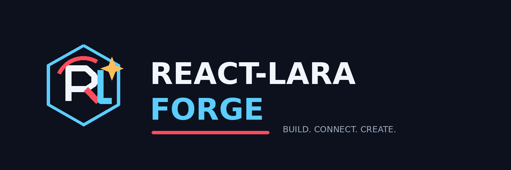
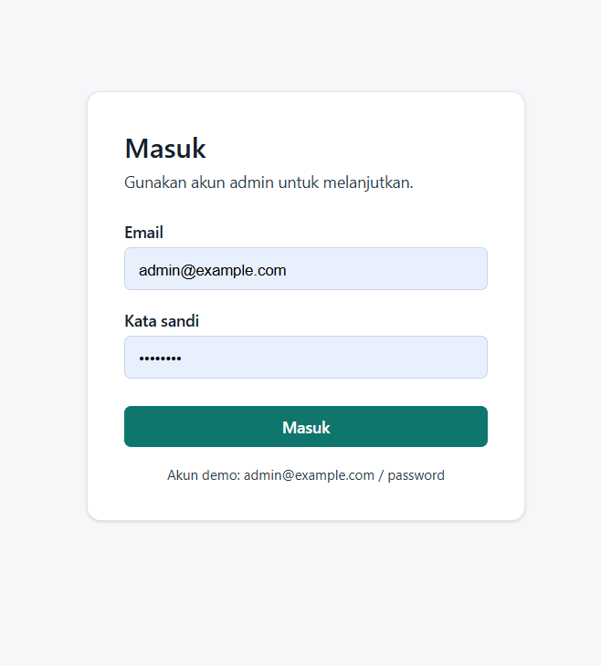
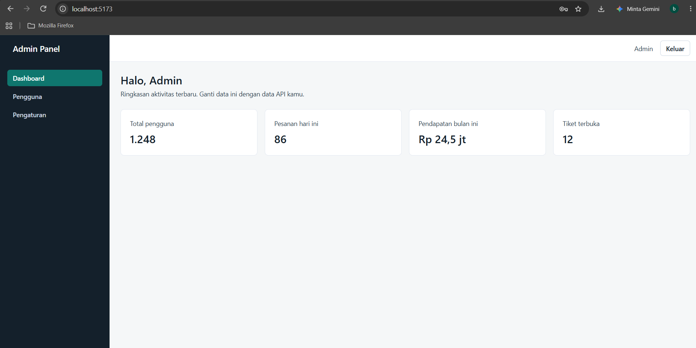

<div align="center">


[English](README.md) | **Bahasa Indonesia**

# React-Lara Forge

**Buat proyek starter Laravel API + React SPA dalam hitungan menit.**

Generator proyek berbasis command line yang menyiapkan backend Laravel dan frontend React secara terpisah, lengkap dengan autentikasi, fitur admin berbasis peran, konfigurasi database, dan antarmuka yang siap dikembangkan.

[](https://nodejs.org/)
[](https://github.com/Bagaas-ind/react-lara-forge/actions/workflows/ci.yml)
[](https://laravel.com/)
[](https://react.dev/)
[](https://vite.dev/)
[](https://tailwindcss.com/)
[](LICENSE)

**Mulai cepat**

```bash
npx github:Bagaas-ind/react-lara-forge my-project
```
</div>

---

## Daftar Isi

- [Gambaran Umum](#gambaran-umum)
- [Fitur](#fitur)
- [Pratinjau](#pratinjau)
- [Persyaratan](#persyaratan)
- [Memulai](#memulai)
- [Opsi CLI](#opsi-cli)
- [Struktur Proyek](#struktur-proyek)
- [Autentikasi dan Keamanan](#autentikasi-dan-keamanan)
- [Konfigurasi Database](#konfigurasi-database)
- [Perintah Pengembangan](#perintah-pengembangan)
- [Pemecahan Masalah](#pemecahan-masalah)
- [Status dan Roadmap](#status-dan-roadmap)
- [Kontribusi](#kontribusi)
- [Lisensi](#lisensi)

## Gambaran Umum

Menyiapkan Laravel API dan React Single-Page Application (SPA) secara terpisah biasanya membutuhkan beberapa konfigurasi berulang: membuat backend, memasang Sanctum, mengatur CORS, menyiapkan Vite dan Tailwind CSS, menghubungkan request API, serta membangun alur autentikasi.

**React-Lara Forge mengotomatiskan tahap persiapan awal tersebut.** Kamu mendapatkan fondasi proyek yang bisa dikembangkan sesuai kebutuhan aplikasi, tanpa harus memulai semuanya dari direktori kosong.

Backend dan frontend dibuat secara terpisah:

- `backend/` — Laravel 12 API.
- `frontend/` — React Single-Page Application.

React-Lara Forge adalah alat pembuat kerangka awal proyek (project scaffold) yang juga cocok untuk belajar. Proyek ini bukan layanan hosting atau aplikasi bisnis siap pakai.

## Instal Manual vs. Menggunakan React-Lara Forge

Membangun fondasi Laravel + React secara manual memberi kamu kendali penuh, tetapi kamu juga perlu mengulang sejumlah proses setup dan integrasi. React-Lara Forge mengotomatiskan sebagian besar pembuatan kerangka awal tersebut.

| Tahap setup | Instalasi manual | Menggunakan React-Lara Forge |
|---|---|---|
| Membuat backend Laravel | Membuat proyek Laravel dan menyiapkan strukturnya sendiri | Membuat kerangka backend Laravel 12 secara otomatis |
| Membuat frontend React | Menyiapkan React, Vite, dan struktur proyek sendiri | Membuat kerangka frontend React 18 + Vite |
| Memasang dependency umum | Mencari dan memasang package yang dibutuhkan satu per satu | Memasang/mengonfigurasi dependency starter sebagai bagian dari proses generate |
| Menghubungkan frontend dan backend | Mengatur URL API dan penanganan request sendiri | Menyediakan fondasi koneksi API yang sudah dikonfigurasi |
| Fondasi autentikasi | Membuat registrasi, login, logout, dan protected route sendiri | Menyediakan starter autentikasi token menggunakan Laravel Sanctum |
| Konfigurasi CORS | Mengatur origin frontend yang diizinkan sendiri | Menyediakan konfigurasi CORS yang bisa disesuaikan |
| Fondasi admin | Membuat dashboard dan halaman manajemen pengguna sendiri | Menyediakan starter admin dashboard dan manajemen pengguna |
| Setup database | Mengatur koneksi database pilihan sendiri | Bisa memilih SQLite, MySQL, atau PostgreSQL saat proses generate |
| Menjalankan server | Membuka terminal dan menjalankan backend/frontend secara terpisah | Menyediakan script praktis `start.bat` dan `start.sh` |

### Mengapa menggunakan React-Lara Forge?

- **Mengurangi setup berulang:** buat struktur awal backend dan frontend dengan satu perintah.
- **Integrasi dasar sudah tersedia:** fondasi API, autentikasi, dan CORS sudah disertakan.
- **Lebih cepat memulai pengembangan:** lebih banyak waktu bisa digunakan untuk menyesuaikan fitur aplikasi daripada mengulang setup boilerplate.
- **Kode tetap dalam kendali kamu:** proyek hasil generate bisa diperiksa, diubah, dikembangkan, dan di-deploy sendiri.

### Apa yang tetap harus kamu kerjakan?

React-Lara Forge tidak menghilangkan proses development. Kamu tetap perlu menyesuaikan tampilan, membuat business logic aplikasi, meninjau pengaturan keamanan, menyiapkan infrastruktur production, dan menguji aplikasi sampai selesai.

Perbandingan ini menjelaskan pekerjaan setup yang dicakup repository ini; langkah yang dibutuhkan bisa berbeda tergantung kebutuhan dan pengalaman masing-masing.


## Fitur

- **Backend dan frontend terpisah** — Laravel API dan React SPA dibuat dalam direktori masing-masing.
- **JavaScript atau TypeScript** — pilih bahasa frontend saat proses setup atau melalui opsi CLI.
- **Pilihan database** — konfigurasi SQLite, MySQL, atau PostgreSQL.
- **Starter autentikasi** — registrasi, login, logout, protected API routes, dan personal access token Laravel Sanctum.
- **Akses berbasis peran** — pengguna terdaftar mendapat peran `user`; seeder untuk pengembangan lokal membuat akun administrator.
- **Admin dashboard** — statistik dashboard dan manajemen pengguna yang terhubung ke database.
- **Otorisasi di sisi server** — aksi khusus administrator dilindungi oleh backend Laravel.
- **Stack frontend modern** — React 18, Vite 6, Tailwind CSS 4, React Router, dan Axios.
- **Script untuk berbagai sistem operasi** — `start.bat` untuk Windows dan `start.sh` untuk macOS/Linux.
- **Proses generate lebih aman** — memvalidasi nama proyek dan direktori yang sudah ada, memeriksa tools yang dibutuhkan, serta membersihkan output yang tidak lengkap ketika proses gagal.

> Saat ini statistik dashboard berfokus pada data pengguna/akun. Fitur seperti pesanan, pembayaran, inventaris, dan pendapatan belum disertakan dan perlu dikembangkan sendiri.

## Pratinjau

<div align="center">
  <table>
    <tr>
      <td align="center"><strong>Halaman Login</strong></td>
      <td align="center"><strong>Admin Dashboard</strong></td>
    </tr>
    <tr>
      <td></td>
      <td></td>
    </tr>
  </table>
</div>

## Persyaratan

Pasang tools berikut sebelum membuat proyek full-stack:

| Tool | Versi | Kegunaan |
|---|---|---|
| Node.js | 18 atau lebih baru | Menjalankan CLI dan tools frontend |
| npm | Termasuk dengan Node.js | Memasang dependency frontend |
| PHP | 8.2 atau lebih baru | Menjalankan backend Laravel 12 |
| Composer | Disarankan 2.x | Membuat dan mengelola aplikasi Laravel |
| Database | SQLite, MySQL, atau PostgreSQL | Menyimpan data aplikasi |

Periksa instalasi:

```bash
node --version
npm --version
php --version
composer --version
```

Untuk MySQL atau PostgreSQL, jalankan server database dan buat database beserta user-nya sebelum menjalankan migration. SQLite menjadi pilihan default dan tidak membutuhkan server database terpisah.

## Memulai

### 1. Generate proyek

```bash
npx github:Bagaas-ind/react-lara-forge my-project
```

Ikuti instruksi untuk memilih JavaScript atau TypeScript serta database. Pilihan default adalah JavaScript dan SQLite.

Generator akan mengunduh Laravel melalui Composer dan memasang dependency frontend melalui npm. Koneksi internet diperlukan saat proses pembuatan awal.

### 2. Jalankan aplikasi

**Windows**

Buka folder proyek yang dihasilkan lalu klik dua kali `start.bat`, atau jalankan:

```powershell
cd my-project
.\start.bat
```

**macOS / Linux**

```bash
cd my-project
chmod +x start.sh
./start.sh
```

Alamat default server pengembangan:

| Aplikasi | URL |
|---|---|
| React frontend | http://localhost:5173 |
| Laravel backend | http://localhost:8000 |

### 3. Buka aplikasi

Kunjungi [http://localhost:5173](http://localhost:5173) melalui browser.

Untuk proyek dengan konfigurasi pengembangan lokal default, kredensial administrator dari seeder adalah:

| Field | Nilai demo lokal |
|---|---|
| Email | `admin@example.com` |
| Password | `password` |

**Penting:** Kredensial ini hanya untuk pengembangan lokal. Ganti atau hapus akun demo sebelum aplikasi dibuka untuk pengguna lain atau di-deploy. Jangan gunakan password demo di production.

## Opsi CLI

Sintaks umum:

```bash
npx github:Bagaas-ind/react-lara-forge <nama-proyek> [options]
```

| Opsi | Keterangan |
|---|---|
| `--typescript` | Menggunakan template frontend TypeScript |
| `--language <language>` | Memilih `javascript` atau `typescript` |
| `--database <driver>` | Memilih `sqlite`, `mysql`, atau `pgsql` |
| `--skip-backend` | Hanya membuat frontend React |
| `--skip-install` | Membuat file tanpa menjalankan `npm install` frontend |
| `--non-interactive` | Menjalankan proses dengan opsi/default tanpa prompt interaktif |
| `-V, --version` | Menampilkan versi CLI |
| `-h, --help` | Menampilkan bantuan |

### Contoh

Membuat proyek TypeScript:

```bash
npx github:Bagaas-ind/react-lara-forge my-app --typescript
```

Membuat proyek JavaScript dengan MySQL tanpa prompt interaktif:

```bash
npx github:Bagaas-ind/react-lara-forge my-app --language javascript --database mysql --non-interactive
```

Membuat frontend saja:

```bash
npx github:Bagaas-ind/react-lara-forge my-frontend --skip-backend
```

Membuat proyek tanpa memasang package frontend:

```bash
npx github:Bagaas-ind/react-lara-forge my-app --skip-install
```

Jika menggunakan `--non-interactive`, pilihan default adalah JavaScript dan SQLite kecuali kamu menentukan opsi lain.

## Struktur Proyek

Direktori yang dihasilkan memiliki struktur umum berikut:

```text
my-project/
├── backend/                     # Laravel 12 API + Sanctum
│   ├── app/Http/Controllers/    # Authentication, dashboard, users
│   ├── config/                  # Konfigurasi aplikasi dan CORS
│   ├── database/
│   │   ├── migrations/
│   │   └── seeders/
│   └── routes/
│       └── api.php
├── frontend/                    # React + Vite + Tailwind CSS
│   ├── src/
│   │   ├── components/
│   │   ├── context/
│   │   ├── lib/
│   │   └── pages/
│   ├── package.json
│   └── vite.config.js            # .ts untuk proyek TypeScript
├── start.bat                     # Launcher Windows
└── start.sh                      # Launcher macOS/Linux
```

File yang dihasilkan dapat sedikit berbeda sesuai bahasa dan opsi generator yang dipilih.

## Autentikasi dan Keamanan

React-Lara Forge menyediakan implementasi awal autentikasi. Pahami konfigurasi default berikut sebelum mengembangkan aplikasi:

- Autentikasi menggunakan **Sanctum personal access token** yang dikirim melalui header `Authorization: Bearer`. Generator tidak mengatur alur autentikasi SPA berbasis stateful cookie milik Sanctum.
- Registrasi publik dibatasi dengan rate limit dan memberikan peran `user`. Operasi khusus administrator diotorisasi oleh backend Laravel.
- Login dilindungi rate limit melalui middleware route Laravel.
- Frontend menyimpan token yang diterima di `localStorage` untuk pengalaman awal yang sederhana. Penyimpanan yang dapat diakses JavaScript meningkatkan dampak risiko cross-site scripting (XSS); tinjau penyimpanan token dan model ancaman sebelum production.
- CORS dikonfigurasi melalui `FRONTEND_URL`. Atur ke origin frontend yang tepat saat deployment. Hindari wildcard origin yang terlalu permisif ketika menggunakan credentials.
- Seeder lokal menggunakan `admin@example.com` / `password` hanya di lingkungan lokal atau testing. Untuk lingkungan lain, atur `ADMIN_NAME`, `ADMIN_EMAIL`, dan `ADMIN_PASSWORD` yang kuat di `backend/.env` sebelum menjalankan seeder.
- Jangan commit file `.env`, kredensial, access token, atau secret production.

**Catatan production:** proyek hasil generate adalah fondasi pengembangan, bukan aplikasi yang telah tersertifikasi keamanannya. Sebelum deployment, tinjau autentikasi, otorisasi, validasi, pengelolaan token, HTTPS, logging, monitoring, backup, pembaruan dependency, dan konfigurasi environment.

## Konfigurasi Database

Generator menuliskan database driver yang dipilih ke `backend/.env`.

| Driver | Keterangan |
|---|---|
| SQLite | Membuat file `backend/database/database.sqlite`; tidak memerlukan server database terpisah. |
| MySQL | Menggunakan konfigurasi koneksi lokal standar. Buat database dan perbarui kredensial di `backend/.env`. |
| PostgreSQL | Menggunakan konfigurasi koneksi lokal standar. Buat database dan perbarui kredensial di `backend/.env`. |

Setelah mengubah pengaturan database, jalankan:

```bash
cd backend
php artisan migrate --seed
```

Jika server database tidak tersedia atau database belum dibuat saat proses generate, perbaiki `backend/.env` lalu jalankan migration setelah database siap.

## Perintah Pengembangan

### Frontend

```bash
cd frontend
npm install
npm run dev
npm run build
```

Untuk proyek TypeScript, jalankan perintah berikut untuk memeriksa tipe frontend:

```bash
npm run typecheck
```

### Backend

```bash
cd backend
php artisan serve
php artisan migrate --seed
```

Base URL API frontend diatur melalui `VITE_API_URL` dalam `frontend/.env`.

## Pemecahan Masalah

<details>
<summary><strong>PHP atau Composer tidak dikenali</strong></summary>

Install PHP dan Composer, tambahkan keduanya ke system `PATH`, lalu buka terminal baru. Verifikasi dengan `php --version` dan `composer --version`.

</details>

<details>
<summary><strong>Frontend tidak dapat terhubung ke API</strong></summary>

Pastikan Laravel berjalan di `http://localhost:8000`. Periksa `VITE_API_URL` di `frontend/.env` dan pastikan `FRONTEND_URL` di `backend/.env` sesuai dengan origin frontend.

</details>

<details>
<summary><strong>Migration MySQL atau PostgreSQL gagal</strong></summary>

Pastikan server database berjalan, database sudah tersedia, dan kredensial di `backend/.env` benar. Kemudian ulangi `php artisan migrate --seed`.

</details>

<details>
<summary><strong>Direktori proyek sudah ada</strong></summary>

Gunakan nama proyek lain. Generator dirancang agar tidak menimpa direktori proyek yang sudah ada.

</details>

<details>
<summary><strong>Dependency frontend belum terpasang</strong></summary>

Buka terminal di direktori hasil generate `frontend/` lalu jalankan `npm install`.

</details>

## Status dan Roadmap

React-Lara Forge masih dalam pengembangan aktif. Repository saat ini berisi generator, template JavaScript dan TypeScript, dokumentasi, serta automated CLI tests.

Area pengembangan berikutnya meliputi:

- Pengujian end-to-end yang lebih menyeluruh untuk proyek Laravel dan React yang dihasilkan.
- Modul starter dan opsi kustomisasi tambahan.
- Catatan rilis dan distribusi berbasis versi yang lebih jelas.
- Contoh serta screenshot tambahan dari proyek hasil generate.

Laporan bug dan masukan yang membangun sangat diterima melalui [GitHub Issues](https://github.com/Bagaas-ind/react-lara-forge/issues).

## Kontribusi

Kontribusi terbuka untuk siapa saja, termasuk perbaikan bug, pengujian, peningkatan dokumentasi, dan usulan fitur.

Sebelum mengirim pull request:

1. Baca [CONTRIBUTING.md](CONTRIBUTING.md).
2. Buat branch khusus dari `main`.
3. Tambahkan atau perbarui test untuk perubahan perilaku.
4. Jalankan `npm test`.
5. Jelaskan perubahan yang dibuat dan cara kamu mengujinya.

Jangan commit folder aplikasi hasil generate, `node_modules`, file `.env`, database lokal, atau secret.

## Lisensi

React-Lara Forge dirilis di bawah [MIT License](LICENSE). Kamu bebas menggunakan, memodifikasi, dan mendistribusikannya sesuai ketentuan lisensi tersebut.

---

<div align="center">

Dibuat agar proses memulai proyek Laravel + React tidak perlu mengulang konfigurasi yang sama.

**Jika React-Lara Forge bermanfaat, pertimbangkan untuk memberikan ⭐ pada repository ini.**

</div>
