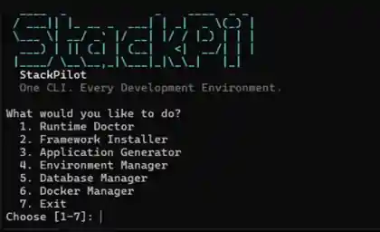

<div align="center">
  
  <h1>StackPilot</h1>
  <p><strong>One CLI. Every Development Environment.</strong></p>
  <p>A terminal toolkit for runtime diagnostics, framework setup, and Laravel + React application scaffolding.</p>
  <p><a href="https://github.com/Bagaas-ind/StackPilot/actions/workflows/ci.yml"></a>  </p>
  <p><strong>English</strong> · <a href="README.id.md">Bahasa Indonesia</a></p>
</div>

<p align="center">
  
</p>

---

## What is StackPilot?

StackPilot brings common development setup tasks into one interactive command-line interface. It helps you inspect local runtimes, launch framework setup workflows, and scaffold a Laravel API + React application starter.

StackPilot is a local developer utility. It does not replace the official tools used by each framework, database, or container platform.

## Terminal workflow

Run StackPilot without arguments to open the interactive menu. Choose a tool, complete its workflow, and return to the main menu. Select **Exit** to close StackPilot.

```text
  ____  _             _    ____  _ _
 / ___|| |_ __ _  ___| | _|  _ \\(_) |
 \\___ \\| __/ _` |/ __| |/ / |_) | | |
  ___) | || (_| | (__|   <|  __/| | |
 |____/ \\__\\__,_|\\___|_|\\_\\_|   |_|

  StackPilot
  One CLI. Every Development Environment.

  1. Runtime Doctor
  2. Framework Installer
  3. Application Generator
  4. Environment Manager
  5. Database Manager
  6. Docker Manager
  7. Exit
```

The main menu is interactive and requires a terminal (TTY). The manager commands below can also be run directly without opening the menu.

## Features

### Runtime Doctor

Checks the availability and reports the detected version of:

- Node.js and npm — required to run StackPilot.
- PHP and Composer.
- Python.
- Java.
- Git.
- Docker.

Node.js 22 and 24 are supported. Other listed tools are optional to the CLI itself and are needed only by workflows that use them. Doctor is diagnostic only; it does not install, update, or remove software.

### Environment Manager

Displays a local inventory of Node.js, npm, PHP, Composer, Python, Python 3, Java, Git, and Docker, along with up to 12 PATH entries. It is read-only: it does not edit PATH or install/uninstall tools. A missing optional executable is reported as not detected; it does not prove that the related service is unavailable.

### Database Manager

Checks for these database command-line clients:

- MySQL: `mysql`
- MariaDB: `mariadb`
- PostgreSQL: `psql`
- SQLite: `sqlite3`
- MongoDB Shell: `mongosh`
- Redis: `redis-cli`

It also performs read-only TCP reachability checks against common local server ports: MySQL/MariaDB (3306 and 3307), PostgreSQL (5432), MongoDB (27017), and Redis (6379). By default it probes `127.0.0.1`; set `STACKPILOT_DB_HOST` to check another host. Each TCP probe has a bounded 700 ms timeout. SQLite is file-based and does not need a server port.

**TCP OPEN** means only that the port accepted a TCP connection. It does not verify the database protocol, credentials, permissions, or query health. MySQL and MariaDB share a compatible port and cannot be distinguished by this check. Client detection and server reachability are reported separately, so a missing CLI does not mean the database server is unavailable. If Docker CLI is available, Docker Compose is also checked.

This manager is read-only: it sends no credentials or SQL queries and never creates, drops, or modifies databases.

### Docker Manager

Checks Docker CLI, daemon reachability, and Docker Compose. When the daemon is reachable, it shows running containers and offers:

1. List all containers.
2. List local images.
3. Start the Compose project in the current directory.
4. Stop the Compose project in the current directory.
5. Return to the main menu.

Compose start/stop requires the Compose plugin, a supported Compose file in the current directory (`compose.yaml`, `compose.yml`, `docker-compose.yml`, or `docker-compose.yaml`), and explicit confirmation. Start runs `docker compose up -d`; stop runs `docker compose down`. Review the Compose file and its effects before confirming.

### Framework Installer

Provides interactive setup workflows for 11 frameworks:

| Ecosystem | Frameworks | Main prerequisites |
| --- | --- | --- |
| PHP | Laravel, CodeIgniter 4, Symfony | PHP and Composer |
| JavaScript | React, Vue.js, Next.js, Express.js | Node.js and npm |
| Python | Django, Flask, FastAPI | Python and pip |
| Java | Spring Boot | Java and `tar` |

The installer validates the project name, checks the required tools, and runs the relevant framework setup command or starter workflow. Python projects are created in a local `.venv`; Spring Boot is downloaded from Spring Initializr. Framework setup may download packages and dependencies, so an internet connection is generally required. Spring Boot setup currently requests Java 17 from Spring Initializr.

### Application Generator

Creates a Laravel API + React SPA starter with:

- Laravel 12 backend and Sanctum API authentication.
- React + Vite frontend, in JavaScript or TypeScript.
- SQLite, MySQL, or PostgreSQL database configuration.
- Starter or ecommerce template selection.
- Frontend-only generation with `--skip-backend`.
- Optional skipping of frontend dependency installation with `--skip-install`.
- Windows and Unix startup scripts when the backend is generated.

The default generator creates both backend and frontend. PHP 8.2+ and Composer 2.x are required unless `--skip-backend` is used. Node.js and npm are always required. The generator runs Composer/Laravel setup commands when creating the backend and can run `npm install` for the frontend.

Generated projects are development starting points, not production security certifications. Review authentication, authorization, CORS, environment secrets, database configuration, dependencies, and deployment hardening before production use.

## Requirements

- The Windows launcher provides a portable Node.js 22 LTS runtime automatically. Running StackPilot directly through `npx` or a local clone requires Node.js 22 or 24 LTS and npm.
- Framework-specific tools only for the workflow you choose.
- PHP 8.2+ and Composer 2.x for Application Generator backend creation.
- Python and pip for Python framework starters.
- Java and `tar` for the Spring Boot installer.
- Docker Engine/Desktop and the Compose plugin for Docker Manager actions.
- Internet access for framework downloads and dependency installation.

## Beginner guide and usage

New to GitHub or the terminal? Start with the [Beginner Guide](docs/BEGINNER_GUIDE.md), then use the [Usage Guide](docs/USAGE.id.md) for detailed CMD, PowerShell, Node.js, troubleshooting, and terminal instructions.

## Install and run

### Windows 10/11 — one command from CMD (no preinstalled Node.js)

**CMD (Command Prompt) is the recommended entry point for Windows beginners.** Open a regular CMD window (no Administrator rights needed), then paste this single line:

```cmd
powershell.exe -NoLogo -NoProfile -Command "irm 'https://raw.githubusercontent.com/Bagaas-ind/StackPilot/main/scripts/install.ps1' | iex"
```

Type this command in CMD. PowerShell runs behind the scenes to execute the launcher; users do not need to open PowerShell or install Node.js, npm, or Git first. The same command also works in the VS Code terminal with either the CMD or PowerShell profile.

The launcher supports Windows 10/11 x64 (Intel/AMD 64-bit), requires internet access, and does not require Administrator rights. It downloads a portable Node.js 22 LTS runtime into `%LOCALAPPDATA%\\StackPilot\\runtime` and verifies the archive against the SHA-256 checksum published by the official Node.js server. It then downloads the StackPilot source ZIP directly from GitHub (Git is not required), installs the dependencies pinned in `package-lock.json`, and starts the CLI. The runtime stays in the current user's profile; the launcher does not modify the machine PATH or install Node.js globally. The existing StackPilot ASCII logo and interactive feature menu are retained. Temporary source files are cleaned up when the app exits.

**Security and compatibility note:** this command downloads and executes the launcher from the StackPilot repository. Run it only if you trust the repository and have reviewed `scripts/install.ps1`; alternatively, download and inspect the script before running it. No command can guarantee absolute security. The launcher currently supports Windows x64 only, not ARM64 or 32-bit Windows. This removes the manual Node.js prerequisite, not every framework prerequisite: Laravel still needs PHP + Composer, Python frameworks need Python, Spring Boot needs Java, and so on. The launcher does not automatically install those framework runtimes.


### Windows PowerShell — one command (no preinstalled Node.js)

If you prefer PowerShell, open a regular PowerShell window (no Administrator rights needed) and run:

```powershell
irm https://raw.githubusercontent.com/Bagaas-ind/StackPilot/main/scripts/install.ps1 | iex
```

Wait until setup finishes and the StackPilot menu appears. This uses the same launcher as the CMD method; portable Node.js 22 LTS is prepared for the current Windows user. The launcher supports Windows 10/11 x64 and requires internet access. Framework runtimes such as PHP/Composer, Python, Java, or Docker are still needed for the workflows that use them.

### Run from GitHub (Node.js already available)

The npm package has not been published. If Node.js 22 or 24 LTS is already available, run the repository source through npm:

```bash
npx --yes github:Bagaas-ind/StackPilot
```

### Clone the repository

```bash
git clone https://github.com/Bagaas-ind/StackPilot.git
cd StackPilot
npm ci
node index.js
```

### Interactive menu

```bash
node index.js
```

Use the menu to open Runtime Doctor, Framework Installer, Application Generator, Environment Manager, Database Manager, or Docker Manager. Most menu actions return to the main menu when finished; choose **Exit** to quit.

### Direct manager commands

```bash
node index.js doctor
node index.js environment
node index.js database
node index.js docker
```

### Generate an application

```bash
# Default Laravel + React starter
node index.js my-app

# React + TypeScript
node index.js my-app --typescript

# Choose MySQL without interactive configuration prompts
node index.js my-app --database mysql --non-interactive

# Frontend only
node index.js my-frontend --skip-backend

# Skip frontend npm install
node index.js my-app --skip-install
```

### Help, version, and language

```bash
node index.js --help
node index.js --version
node index.js --lang id
node index.js doctor --lang id
```

### Application Generator options

| Option | Purpose |
| --- | --- |
| `--template <starter|ecommerce>` | Select the application template |
| `--typescript` | Use the React + TypeScript frontend |
| `--language <javascript|typescript>` | Explicitly select the frontend language |
| `--database <sqlite|mysql|pgsql>` | Select the Laravel database driver |
| `--laravel-version <version>` | Select the Laravel version (default: `12.*`) |
| `--skip-backend` | Generate frontend only |
| `--skip-install` | Skip frontend `npm install` |
| `--non-interactive` | Use the supplied options/defaults without configuration prompts |
| `--lang <en|id>` | Select the CLI interface language |

When using a local clone, run commands with `node index.js`. The npm package is not yet published to the npm registry.

## Tests and CI

Run the test suite locally:

```bash
npm ci
npm test
```

The test suite uses Node's built-in test runner. Platform-specific tests may be skipped when the current operating system cannot run them; a skipped test is not a passing execution on that platform.

GitHub Actions checks the CLI on Windows, macOS, and Ubuntu with Node.js 22 and 24. It also lints PHP templates and generates test applications to build the frontend and run Laravel feature tests.

## Project status

| Component | Scope |
| --- | --- |
| Runtime Doctor | Runtime detection and Node.js compatibility reporting |
| Environment Manager | Runtime inventory and PATH overview; read-only |
| Database Manager | Database client detection and local TCP reachability checks; read-only |
| Docker Manager | Docker/Compose diagnostics, container/image listing, confirmed Compose actions |
| Framework Installer | Interactive setup workflows for 11 frameworks |
| Application Generator | Laravel 12 API + React/Vite starter generation |

## Troubleshooting

- **Node.js version rejected:** use Node.js 22 or 24 LTS, then reopen the terminal.
- **A tool shows MISSING / NOT FOUND:** check that the executable is installed and available in the current terminal's PATH. Restart the terminal after changing PATH.
- **Docker daemon unavailable:** start Docker Desktop/Engine and wait until the daemon is ready.
- **Compose action unavailable:** install/enable the Docker Compose plugin and place a supported Compose file in the current working directory.
- **Framework setup fails:** check the framework's runtime prerequisites, internet connection, and the full output printed by the underlying setup command.
- **Application Generator backend fails:** verify PHP 8.2+, Composer 2.x, and the selected database configuration. Use `--skip-backend` only when you intentionally want a frontend-only project.

## Security

StackPilot executes framework setup commands and creates files in the selected project directory. Docker Compose actions can start or stop services in the current directory after confirmation. Review commands, Compose files, and generated code before using them in important environments. Never commit secrets or real credentials. Generated applications must be reviewed and hardened before deployment.

## Contributing

Bug reports, documentation improvements, tests, and focused pull requests are welcome. See [CONTRIBUTING.md](CONTRIBUTING.md). For vulnerability reports, follow [SECURITY.md](SECURITY.md).

## License

MIT — see [LICENSE](LICENSE).
