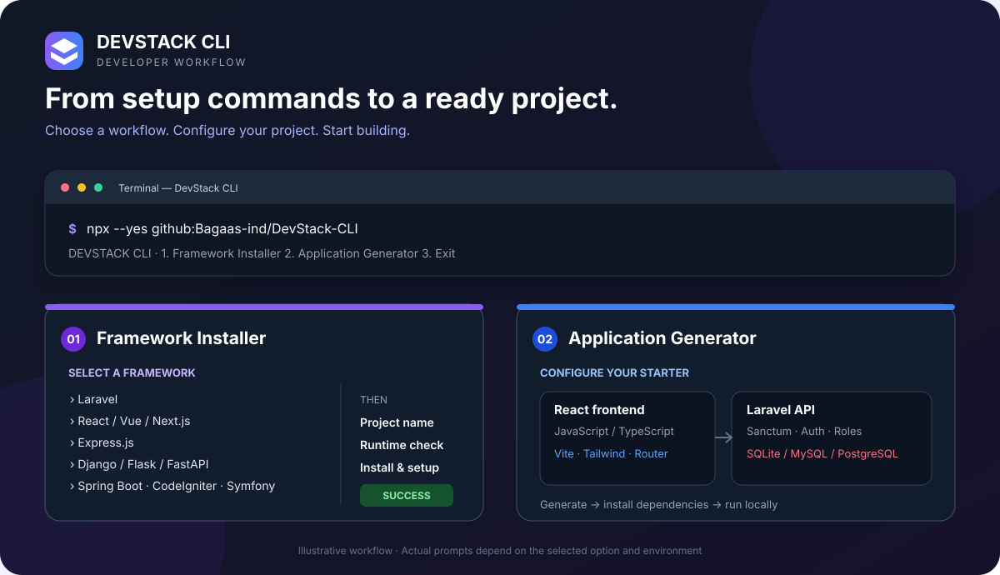

<!--
  DevStack CLI — project documentation
  Keep feature claims aligned with lib/frameworks.js and index.js.
-->

<div align="center">
  

  <h1>DevStack CLI</h1>
  <p><strong>One CLI. Framework setup and application scaffolding.</strong></p>
  <p>Set up your development environment and start building without memorizing every setup command.</p>

  <p>
    <a href="https://github.com/Bagaas-ind/DevStack-CLI/actions/workflows/ci.yml"></a>
    
    
    <a href="https://github.com/Bagaas-ind/DevStack-CLI/stargazers"></a>
    <a href="https://github.com/Bagaas-ind/DevStack-CLI/issues"></a>
  </p>

  <p><a href="README.md">English</a> · <a href="README.id.md">Bahasa Indonesia</a></p>
</div>

---

## What is DevStack CLI?

**DevStack CLI** is an interactive developer tool that brings two common workflows into one command-line interface:

- **Framework Installer** — creates a fresh project for a supported framework and prepares its initial dependencies.
- **Application Generator** — scaffolds a Laravel API + React SPA starter with authentication, database configuration, and a ready-to-customize frontend.

Instead of jumping between setup guides and remembering commands, choose a workflow, follow the prompts, and let DevStack CLI handle the initial project setup.

## See the workflow

The illustration below is a representative walkthrough of the CLI experience. The exact commands and output can vary by framework, operating system, and installed tools.

<p align="center">
  
</p>

### Two workflows, one CLI

| Workflow | What it does |
| --- | --- |
| Framework Installer | Select a framework, enter a project name, check required runtimes, then create the starter project and install its initial dependencies. |
| Application Generator | Configure a Laravel API + React SPA starter, choose JavaScript or TypeScript, and select a database. |

## Supported framework installers

The interactive installer currently offers:

| Ecosystem | Frameworks | Setup approach |
| --- | --- | --- |
| PHP | Laravel, CodeIgniter 4, Symfony | Composer project creation |
| JavaScript | React, Vue.js | Vite project scaffolding |
| JavaScript | Next.js | create-next-app |
| JavaScript | Express.js | Express dependency and starter server |
| Python | Django, Flask, FastAPI | Virtual environment and package installation |
| Java | Spring Boot | Project download from Spring Initializr |

DevStack CLI checks that the relevant command-line runtimes are available before starting. It does **not** install Node.js, PHP, Composer, Python, Java, or database servers for you.

## Requirements

Install the runtime for the framework you intend to use before running its installer.

| Tool | Used by |
| --- | --- |
| Node.js and npm | DevStack CLI, React, Vue.js, Next.js, Express.js |
| PHP and Composer | Laravel, CodeIgniter 4, Symfony |
| Python | Django, Flask, FastAPI |
| Java (JDK 17+) and `tar` | Spring Boot |
| Node.js 22 or 24 | Supported CLI runtime |

Some frameworks may require additional system libraries or services depending on your environment. A database server is not installed automatically.

Check your tools:

```bash
node --version
npm --version
php --version
composer --version
python --version
java --version
```

Only the commands relevant to your chosen framework need to be installed.

## Installation

### Option 1 — Run directly from GitHub

No global installation is needed:

```bash
npx --yes github:Bagaas-ind/DevStack-CLI
```

This starts the interactive main menu. The first run downloads the CLI from GitHub, so an internet connection is required.

### Option 2 — Clone and run locally

```bash
git clone https://github.com/Bagaas-ind/DevStack-CLI.git
cd DevStack-CLI
npm install
node index.js
```

To run the automated test suite:

```bash
npm test
```

> **Package availability:** The commands above use the GitHub repository. They do not imply that the package has been published to the npm registry.

## Quick start

### 1. Open the main menu

```bash
npx --yes github:Bagaas-ind/DevStack-CLI
```

Choose one of the available workflows:

```text
  DEVSTACK CLI
  Install Frameworks. Build Projects. Start Coding.

  What would you like to do?
    1. Framework Installer
    2. Application Generator
    3. Exit
```

### 2. Create a framework project

For example, choose **Framework Installer**, select **Laravel**, and enter a project name:

```text
  FRAMEWORK INSTALLER

  Select a framework:

    1. Laravel (PHP)
    2. CodeIgniter 4 (PHP)
    3. Symfony (PHP)
    4. React (JavaScript)
    5. Vue.js (JavaScript)
    6. Next.js (JavaScript)
    7. Express.js (JavaScript)
    8. Django (Python)
    9. Flask (Python)
   10. FastAPI (Python)
   11. Spring Boot (Java)
    0. Back

  Choose a number: 1
  Enter project name: my-laravel-app

  Checking requirements...
  Installing Laravel...

  [SUCCESS] Installation completed successfully!

  Next steps:
    cd my-laravel-app
    php artisan serve
```

The example above illustrates the interaction; actual installation output is produced by the underlying framework tools.

### 3. Start the generated framework

Use the next-step command printed by DevStack CLI. Common examples:

| Framework | Next step |
| --- | --- |
| Laravel | `php artisan serve` |
| CodeIgniter 4 | `php spark serve` |
| Symfony | `symfony server:start` |
| React / Vue.js | `npm run dev` |
| Next.js | `npm run dev` |
| Express.js | `npm start` |
| Django | Activate `.venv`, then `python manage.py runserver` |
| Flask | Activate `.venv`, then `python app.py` |
| FastAPI | Activate `.venv`, then `uvicorn main:app --reload` |
| Spring Boot | `./mvnw spring-boot:run` |

On Windows, use the virtual-environment activation script under `.venv\\Scripts\\` for Python projects.

## Application Generator

The second workflow generates a separate **Laravel API backend** and **React single-page application**.

### Included foundation

- Laravel 12.x backend with Sanctum personal access token authentication.
- React 18 frontend with Vite 6, Tailwind CSS 4, React Router, and Axios.
- JavaScript or TypeScript frontend selection.
- SQLite, MySQL, or PostgreSQL configuration.
- Registration, login, logout, protected API routes, and role-based authorization.
- Local development administrator seeder, dashboard, and user management.
- Windows and macOS/Linux launcher scripts.

### Generate a project

From the main menu, choose **Application Generator** and enter a project name. You can also run the generator directly:

```bash
npx --yes github:Bagaas-ind/DevStack-CLI my-app
```

Useful options:

| Option | Description |
| --- | --- |
| `--typescript` | Use the TypeScript frontend |
| `--language <language>` | Choose `javascript` or `typescript` |
| `--database <driver>` | Choose `sqlite`, `mysql`, or `pgsql` |
| `--laravel-version <version>` | Select the Laravel version; default is `12.*` |
| `--skip-backend` | Generate only the React frontend |
| `--skip-install` | Skip frontend `npm install` |
| `--non-interactive` | Use supplied options and defaults without prompts |
| `--lang <en\|id>` | Set the CLI interface language |

Examples:

```bash
# React + TypeScript + SQLite
npx --yes github:Bagaas-ind/DevStack-CLI my-app --typescript

# React + JavaScript + MySQL
npx --yes github:Bagaas-ind/DevStack-CLI my-app --language javascript --database mysql --non-interactive

# Frontend only
npx --yes github:Bagaas-ind/DevStack-CLI my-frontend --skip-backend

# Indonesian CLI interface
npx --yes github:Bagaas-ind/DevStack-CLI --lang id
```

The generator downloads Laravel through Composer and installs frontend dependencies through npm. An internet connection is required during generation.

### Run the generated application

**Windows**

```powershell
cd my-app
.\\start.bat
```

**macOS / Linux**

```bash
cd my-app
chmod +x start.sh
./start.sh
```

Default local development addresses:

| Service | Address |
| --- | --- |
| React frontend | http://localhost:5173 |
| Laravel backend | http://localhost:8000 |

For the default local development setup, the seeded administrator credentials are:

| Field | Demo value |
| --- | --- |
| Email | `admin@example.com` |
| Password | `password` |

**Security:** These credentials are for local development only. Change or remove the demo account before exposing the application to other users. Never use the demo password in production.

## Generated project structure

```text
my-app/
├── backend/                 # Laravel API + Sanctum
│   ├── app/Http/Controllers/
│   ├── database/
│   │   ├── migrations/
│   │   └── seeders/
│   └── routes/
│       └── api.php
├── frontend/                # React + Vite + Tailwind CSS
│   ├── src/
│   ├── package.json
│   └── vite.config.js       # .ts for TypeScript projects
├── start.bat                # Windows launcher
└── start.sh                 # macOS / Linux launcher
```

Exact files may vary with the selected language and generator options.

## Security notes

The generated starter uses Laravel Sanctum personal access tokens sent through the `Authorization: Bearer` header. It does not configure Sanctum's stateful cookie-based SPA authentication flow.

- Public registration is rate-limited and assigns the `user` role.
- Administrator-only operations are authorized by the Laravel backend.
- The frontend stores the returned token in `localStorage`. JavaScript-accessible storage increases the impact of cross-site scripting (XSS); review token storage and your threat model before production use.
- CORS is configured through `FRONTEND_URL`. Set it to the exact frontend origin used by your deployment.
- Do not commit `.env` files, credentials, access tokens, or production secrets.

Generated projects are development foundations, not production security certifications. Review authentication, authorization, validation, token handling, HTTPS, logging, monitoring, backups, dependency updates, and environment configuration before deployment.

## Development and tests

```bash
npm install
npm test
```

The CI workflow checks the CLI across the configured Node.js and operating-system matrix and exercises project-generation behavior.

## Contributing

Contributions, bug reports, documentation improvements, and feature suggestions are welcome.

1. Create a focused branch from `main`.
2. Add or update tests for behavior changes.
3. Run `npm test`.
4. Explain what changed and how you tested it in your pull request.

Do not commit generated application folders, `node_modules`, `.env` files, local databases, or secrets.

## License

DevStack CLI is released under the [MIT License](LICENSE).

---

<div align="center">
  
  <p><strong>Install Frameworks. Build Projects. Start Coding.</strong></p>
  <sub>Built to make the first steps of development simpler.</sub>
</div>
