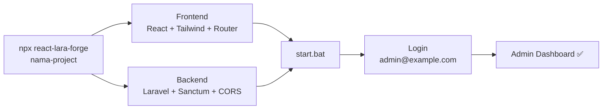

<div align="center">

# ⚡ React-Lara Forge

### Satu perintah untuk membuat starter full-stack **Laravel + React** yang langsung bisa login.

*One command to scaffold a Laravel API + React SPA with Sanctum auth, CORS, Tailwind, and an admin dashboard.*


[](https://github.com/Bagaas-ind/react-lara-forge/stargazers)

```bash
npx github:Bagaas-ind/react-lara-forge nama-project
```

| Login | Admin Dashboard |
|:---:|:---:|
|  |  |

</div>

---

## 😩 Masalahnya

Setiap memulai proyek Laravel + React, hal yang sama selalu diulang: memasang Sanctum,
mengatur CORS, memasang Tailwind, menyiapkan React Router, membuat halaman login,
lalu membuat layout dashboard. Biasanya memakan **2-3 jam** sebelum satu fitur pun ditulis.

## ✨ Solusinya

React-Lara Forge mengerjakan semua itu dengan satu perintah. Kamu langsung mendapat
backend dan frontend yang sudah tersambung, lengkap dengan login dan dashboard.



## 🎁 Yang kamu dapat

| | |
|---|---|
| 🔐 **Autentikasi siap pakai** | Login dan logout dengan token Laravel Sanctum, rute dilindungi di frontend |
| 🌐 **CORS sudah benar** | Backend dan frontend langsung bisa saling bicara |
| 🎨 **Admin Dashboard** | Sidebar responsif, halaman Dashboard, Pengguna, dan Pengaturan |
| ⚡ **Frontend modern** | React 18, Vite, Tailwind CSS v4, React Router, axios |
| 🚀 **Satu klik jalan** | `start.bat` (Windows) / `start.sh` (Mac/Linux) menjalankan backend dan frontend sekaligus |
| 🧪 **Akun demo** | Seeder membuat `admin@example.com` / `password` |

## ⏱️ Before vs After

| | Setup manual | Dengan React-Lara Forge |
|---|---|---|
| **Waktu setup awal** | 2-3 jam | Beberapa menit (kebanyakan menunggu unduhan Laravel) |
| **Sanctum + CORS** | Dikonfigurasi dan di-debug sendiri | Sudah terkonfigurasi |
| **Tailwind + Router + axios** | Dipasang satu per satu | Sudah terpasang |
| **Login + layout admin** | Dibangun dari nol | Sudah ada, tinggal diisi fitur |
| **Menjalankan project** | Dua terminal, ingat perintahnya | Klik `start.bat` |

## 📋 Prasyarat

- [Node.js](https://nodejs.org) 18 atau lebih baru
- [PHP](https://www.php.net) 8.2 atau lebih baru
- [Composer](https://getcomposer.org)

Database bawaan memakai **SQLite**, jadi tidak perlu menginstal MySQL. Bisa diganti kapan saja lewat `backend/.env`.

## 🚀 Mulai dalam 3 langkah

### 1. Buat project

```bash
npx github:Bagaas-ind/react-lara-forge nama-project
```

Proses ini mengunduh Laravel lewat Composer, jadi butuh internet dan bisa memakan beberapa menit.

### 2. Jalankan

**Cara tercepat:**

| Sistem | Perintah |
|---|---|
| Windows | Klik dua kali `nama-project/start.bat` |
| Mac / Linux | `cd nama-project && ./start.sh` |

**Atau manual**, di dua terminal terpisah:

```bash
# Terminal 1: backend
cd nama-project/backend
php artisan serve
```

```bash
# Terminal 2: frontend
cd nama-project/frontend
npm install
npm run dev
```

### 3. Buka dan login

Buka **http://localhost:5173** lalu masuk dengan:

- Email: `admin@example.com`
- Kata sandi: `password`

## 📁 Struktur project hasil generate

```
nama-project/
├── backend/            Laravel (API + Sanctum)
│   ├── app/Http/Controllers/AuthController.php
│   ├── routes/api.php
│   └── config/cors.php
├── frontend/           React + Vite + Tailwind
│   └── src/
│       ├── pages/          Login, Dashboard, Users, Settings
│       ├── components/     AdminLayout, ProtectedRoute
│       ├── context/        AuthContext
│       └── lib/api.js      axios + token otomatis
├── start.bat           Jalankan semuanya (Windows)
└── start.sh            Jalankan semuanya (Mac/Linux)
```

## ⚙️ Cara kerjanya

1. Menyalin template frontend React ke `frontend/`.
2. Membuat project Laravel terbaru ke `backend/` dengan `composer create-project`.
3. Memasang Sanctum (`php artisan install:api`) dan menambahkan trait `HasApiTokens` ke model `User`.
4. Menimpa route, controller, konfigurasi CORS, dan seeder dengan versi template.
5. Menjalankan migrasi dan seeder.
6. Menyalin `start.bat` dan `start.sh`.

Autentikasi memakai **token Bearer Sanctum**: login mengembalikan token, frontend menyimpannya
dan mengirimnya di setiap request. Ini lebih sederhana daripada mode cookie SPA karena tidak
perlu mengatur CSRF dan domain.

## 🛠️ Opsi CLI

```bash
react-lara-forge <nama-project> [opsi]
```

| Opsi | Fungsi |
|---|---|
| `--skip-backend` | Hanya membuat frontend (tanpa Laravel) |
| `--version` | Menampilkan versi |
| `--help` | Menampilkan bantuan |

## 🤔 Kenapa bukan Laravel Breeze / Starter Kit?

Breeze dengan Inertia menyatukan frontend dan backend dalam satu aplikasi.
React-Lara Forge untuk kamu yang ingin **API Laravel dan SPA React yang terpisah**:
bisa di-deploy sendiri-sendiri, dan API yang sama bisa dipakai nanti oleh aplikasi mobile.

## 🩹 Pemecahan masalah

**"Tidak bisa terhubung ke server" di halaman login**
Backend belum jalan. Jalankan `php artisan serve` di folder `backend`, atau pakai `start.bat`.

**"PHP tidak ditemukan" / "Composer tidak ditemukan"**
Pasang PHP 8.2+ dan Composer, lalu buka terminal baru. Cek dengan `php -v` dan `composer -V`.

**Error CORS di browser**
Pastikan frontend berjalan di `http://localhost:5173`. Kalau memakai alamat lain, ubah `FRONTEND_URL` di `backend/.env`.

**`start.bat` berkata "Folder backend tidak ditemukan"**
Project dibuat dengan `--skip-backend`, atau `start.bat` dipindahkan dari folder project. Buat ulang tanpa opsi itu.

**Folder sudah ada**
CLI tidak menimpa folder yang sudah ada. Pilih nama project lain.

**Mengubah alamat API**
Edit `VITE_API_URL` di `frontend/.env` (bawaan: `http://localhost:8000/api`).

## 💻 Pengembangan lokal

Ingin ikut mengembangkan CLI-nya?

```bash
git clone https://github.com/Bagaas-ind/react-lara-forge.git
cd react-lara-forge
npm install
npm link
react-lara-forge test-project
```

## 🗺️ Roadmap

- [x] Template Laravel + React dengan login dan admin dashboard
- [x] Skrip `start.bat` / `start.sh`
- [ ] Publikasi ke npm (`npx react-lara-forge`)
- [ ] Opsi TypeScript (`--ts`)
- [ ] Prompt interaktif untuk memilih fitur
- [ ] Generator modul CRUD
- [ ] Mode autentikasi cookie SPA
- [ ] Dark mode

Punya ide atau menemukan bug? [Buka issue](https://github.com/Bagaas-ind/react-lara-forge/issues).

## 🤝 Kontribusi

Pull request sangat diterima. Fork repo ini, buat branch, lalu ajukan PR.
Untuk perubahan besar, buka issue dulu agar bisa didiskusikan.

## 📄 Lisensi

[MIT](LICENSE) © [Bagaas-ind](https://github.com/Bagaas-ind)

---

<div align="center">

**Kalau project ini menghemat waktumu, kasih ⭐ ya!**

</div>
