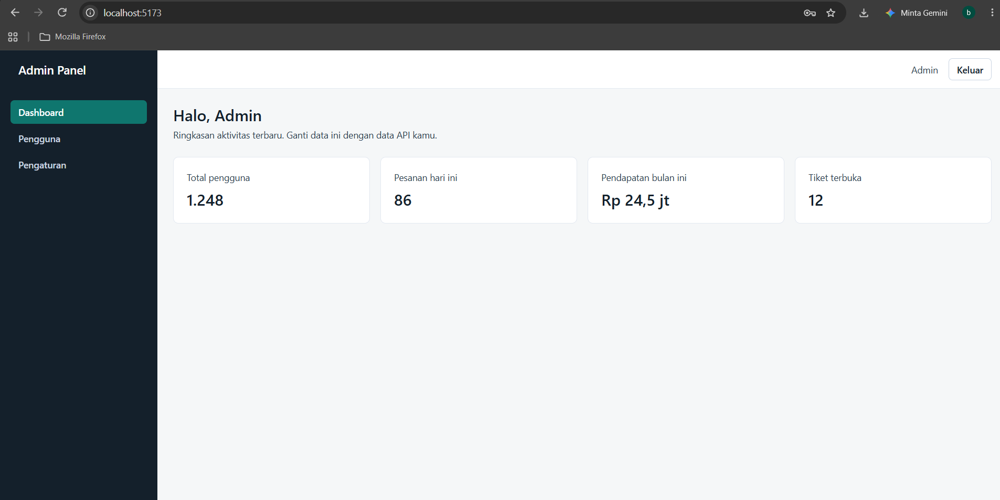

<div align="center">


# React-Lara Forge

**Generate a Laravel API + React SPA starter project in minutes.**

A command-line project generator that scaffolds a separate Laravel backend and React frontend, with authentication, role-based admin features, database configuration, and a ready-to-customize interface.

[](https://nodejs.org/)
[](https://github.com/Bagaas-ind/react-lara-forge/actions/workflows/ci.yml)
[](https://laravel.com/)
[](https://react.dev/)
[](https://vite.dev/)
[](https://tailwindcss.com/)
[](LICENSE)

**Quick start**

```bash
npx github:Bagaas-ind/react-lara-forge my-project
```

</div>

---

## Table of contents

- [Overview](#overview)
- [Features](#features)
- [Preview](#preview)
- [Requirements](#requirements)
- [Quick start](#quick-start)
- [CLI options](#cli-options)
- [Generated project structure](#generated-project-structure)
- [Authentication and security](#authentication-and-security)
- [Database configuration](#database-configuration)
- [Development commands](#development-commands)
- [Troubleshooting](#troubleshooting)
- [Project status and roadmap](#project-status-and-roadmap)
- [Contributing](#contributing)
- [License](#license)

## Overview

Starting a Laravel API and a separate React single-page application often involves repeating the same setup: creating the backend, installing Sanctum, configuring CORS, preparing Vite and Tailwind CSS, connecting API requests, and building an authentication flow.

**React-Lara Forge automates that initial setup.** It gives you a practical foundation that you can customize for your own application instead of starting from an empty directory.

The generated project keeps the backend and frontend separate:

- `backend/` — Laravel 12 API.
- `frontend/` — React single-page application.

React-Lara Forge is a project starter and learning-friendly scaffold. It is not a hosted service or a finished business application.

## Features

- **Separate backend and frontend** — Laravel API and React SPA are generated in their own directories.
- **JavaScript or TypeScript** — choose the frontend language during setup or with a CLI option.
- **Database selection** — configure SQLite, MySQL, or PostgreSQL.
- **Authentication starter** — registration, login, logout, protected API routes, and Laravel Sanctum personal access tokens.
- **Role-based access** — registered users receive the `user` role; the local development seeder creates an administrator account.
- **Admin dashboard** — dashboard statistics and user management backed by the database.
- **Server-side authorization** — administrator-only API actions are protected on the Laravel backend.
- **Modern frontend stack** — React 18, Vite 6, Tailwind CSS 4, React Router, and Axios.
- **Cross-platform launch scripts** — `start.bat` for Windows and `start.sh` for macOS/Linux.
- **Safer generation** — validates project names and existing paths, checks required tools, and cleans up incomplete output after fatal generation errors.

> Dashboard statistics currently focus on user/account data. Features such as orders, payments, inventory, and revenue are not included and must be developed separately.

## Preview

<div align="center">
  <table>
    <tr>
      <td align="center"><strong>Login</strong></td>
      <td align="center"><strong>Admin dashboard</strong></td>
    </tr>
    <tr>
      <td></td>
      <td></td>
    </tr>
  </table>
</div>

## Requirements

Install these tools before generating a full-stack project:

| Tool | Version | Purpose |
|---|---|---|
| Node.js | 18 or newer | Runs the CLI and frontend tooling |
| npm | Included with Node.js | Installs frontend dependencies |
| PHP | 8.2 or newer | Runs the Laravel 12 backend |
| Composer | 2.x recommended | Creates and manages the Laravel application |
| Database | SQLite, MySQL, or PostgreSQL | Stores application data |

Check your installations:

```bash
node --version
npm --version
php --version
composer --version
```

For MySQL or PostgreSQL, start the database server and create the database and database user before running migrations. SQLite is the default and does not require a separate database server.

## Quick start

### 1. Generate a project

```bash
npx github:Bagaas-ind/react-lara-forge my-project
```

Follow the prompts to choose JavaScript or TypeScript and a database. The default choices are JavaScript and SQLite.

The generator downloads Laravel through Composer and installs frontend dependencies through npm. An internet connection is required during initial generation.

### 2. Start the applications

**Windows**

Open the generated folder and double-click `start.bat`, or run:

```powershell
cd my-project
.\start.bat
```

**macOS / Linux**

```bash
cd my-project
chmod +x start.sh
./start.sh
```

The development servers use these default addresses:

| Application | URL |
|---|---|
| React frontend | http://localhost:5173 |
| Laravel backend | http://localhost:8000 |

### 3. Open the application

Visit [http://localhost:5173](http://localhost:5173) in your browser.

For a project generated with the default local development configuration, the seeded administrator credentials are:

| Field | Local demo value |
|---|---|
| Email | `admin@example.com` |
| Password | `password` |

**Important:** These are local development credentials only. Change or remove the demo account before exposing the application to other users or deploying it. Never use the demo password in production.

## CLI options

General syntax:

```bash
npx github:Bagaas-ind/react-lara-forge <project-name> [options]
```

| Option | Description |
|---|---|
| `--typescript` | Use the TypeScript frontend template |
| `--language <language>` | Choose `javascript` or `typescript` |
| `--database <driver>` | Choose `sqlite`, `mysql`, or `pgsql` |
| `--skip-backend` | Generate only the React frontend |
| `--skip-install` | Generate files without running frontend `npm install` |
| `--non-interactive` | Run with options/defaults without interactive prompts |
| `-V, --version` | Display the CLI version |
| `-h, --help` | Display help |

### Examples

Generate a TypeScript project:

```bash
npx github:Bagaas-ind/react-lara-forge my-app --typescript
```

Generate a JavaScript project with MySQL without interactive prompts:

```bash
npx github:Bagaas-ind/react-lara-forge my-app --language javascript --database mysql --non-interactive
```

Generate only the frontend:

```bash
npx github:Bagaas-ind/react-lara-forge my-frontend --skip-backend
```

Generate the project without installing frontend packages:

```bash
npx github:Bagaas-ind/react-lara-forge my-app --skip-install
```

When using `--non-interactive`, JavaScript and SQLite are selected by default unless you override them with options.

## Generated project structure

The generated directory follows this general structure:

```text
my-project/
├── backend/                     # Laravel 12 API + Sanctum
│   ├── app/Http/Controllers/    # Authentication, dashboard, users
│   ├── config/                  # Application and CORS configuration
│   ├── database/
│   │   ├── migrations/
│   │   └── seeders/
│   └── routes/
│       └── api.php
├── frontend/                    # React + Vite + Tailwind CSS
│   ├── src/
│   │   ├── components/
│   │   ├── context/
│   │   ├── lib/
│   │   └── pages/
│   ├── package.json
│   └── vite.config.js            # .ts for TypeScript projects
├── start.bat                     # Windows launcher
└── start.sh                      # macOS/Linux launcher
```

Exact files may vary slightly depending on the selected language and generator options.

## Authentication and security

React-Lara Forge provides a starting authentication implementation. Understand these defaults before adapting the generated application:

- Authentication uses **Sanctum personal access tokens** sent with the `Authorization: Bearer` header. The generator does not configure Sanctum's stateful cookie-based SPA authentication flow.
- Public registration is rate-limited and assigns the `user` role. Administrator-only operations are authorized by the Laravel backend.
- Login is rate-limited by Laravel route middleware.
- The frontend stores the returned token in `localStorage` for a straightforward starter experience. JavaScript-accessible storage increases the impact of cross-site scripting (XSS); review token storage and your threat model before production use.
- CORS is configured through `FRONTEND_URL`. Set this to the exact frontend origin used by your deployment. Avoid permissive wildcard origins when credentials are involved.
- The local seeder uses `admin@example.com` / `password` only in local or testing environments. For other environments, configure `ADMIN_NAME`, `ADMIN_EMAIL`, and a strong `ADMIN_PASSWORD` in `backend/.env` before seeding.
- Do not commit `.env` files, credentials, access tokens, or production secrets.

**Production note:** generated projects are development foundations, not security-certified applications. Before deployment, review authentication, authorization, validation, token handling, HTTPS, logging, monitoring, backups, dependency updates, and environment configuration.

## Database configuration

The generator writes the selected database driver to `backend/.env`.

| Driver | Notes |
|---|---|
| SQLite | Creates `backend/database/database.sqlite`; no separate database server is needed. |
| MySQL | Uses standard local connection defaults. Create the database and update credentials in `backend/.env`. |
| PostgreSQL | Uses standard local connection defaults. Create the database and update credentials in `backend/.env`. |

After changing database settings, run:

```bash
cd backend
php artisan migrate --seed
```

If the database server is unavailable or the database does not exist during generation, correct `backend/.env` and run the migration command once the database is ready.

## Development commands

### Frontend

```bash
cd frontend
npm install
npm run dev
npm run build
```

For a TypeScript project, run the following command to check frontend types:

```bash
npm run typecheck
```

### Backend

```bash
cd backend
php artisan serve
php artisan migrate --seed
```

The frontend API base URL is configured in `frontend/.env` through `VITE_API_URL`.

## Troubleshooting

<details>
<summary><strong>PHP or Composer is not recognized</strong></summary>

Install PHP and Composer, add them to your system `PATH`, then open a new terminal. Verify with `php --version` and `composer --version`.

</details>

<details>
<summary><strong>The frontend cannot connect to the API</strong></summary>

Make sure Laravel is running at `http://localhost:8000`. Check `VITE_API_URL` in `frontend/.env` and confirm that `FRONTEND_URL` in `backend/.env` matches the frontend origin.

</details>

<details>
<summary><strong>MySQL or PostgreSQL migration fails</strong></summary>

Confirm that the database server is running, the database exists, and the credentials in `backend/.env` are correct. Then retry `php artisan migrate --seed`.

</details>

<details>
<summary><strong>The project directory already exists</strong></summary>

Choose a different project name. The generator is designed not to overwrite an existing project directory.

</details>

<details>
<summary><strong>Frontend dependencies are missing</strong></summary>

Open a terminal in the generated `frontend/` directory and run `npm install`.

</details>

## Project status and roadmap

React-Lara Forge is under active development. The current repository contains the generator, JavaScript and TypeScript templates, documentation, and automated CLI tests.

Planned areas of improvement include:

- More comprehensive end-to-end tests for generated Laravel and React projects.
- Additional starter modules and customization options.
- Clearer release notes and versioned distribution.
- More examples and screenshots of generated projects.

Bug reports and constructive feedback are welcome through [GitHub Issues](https://github.com/Bagaas-ind/react-lara-forge/issues).

## Contributing

Contributions are welcome, including bug fixes, tests, documentation improvements, and feature suggestions.

Before submitting a pull request:

1. Read [CONTRIBUTING.md](CONTRIBUTING.md).
2. Create a focused branch from `main`.
3. Add or update tests for behavior changes.
4. Run `npm test`.
5. Explain what changed and how you tested it.

Please do not commit generated application folders, `node_modules`, `.env` files, local databases, or secrets.

## License

React-Lara Forge is released under the [MIT License](LICENSE). You are free to use, modify, and distribute it under the terms of that license.

---

<div align="center">

Made to make starting Laravel + React projects less repetitive.

**If React-Lara Forge is useful to you, consider giving the repository a ⭐ on GitHub.**

</div>
