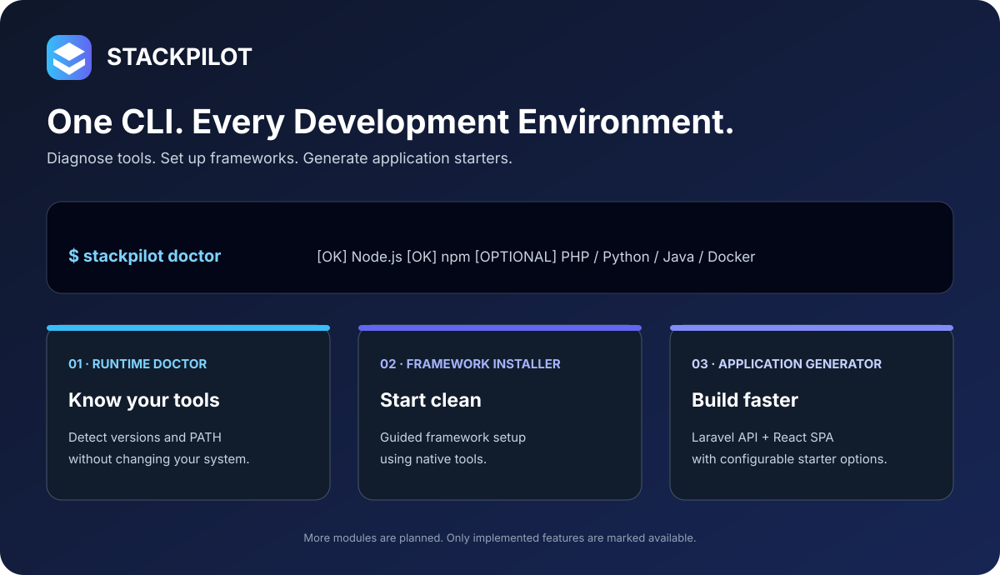

  
  <h1>StackPilot</h1>
  
<strong>One CLI. Every Development Environment.</strong>

  
A command-line companion for runtime diagnostics, framework setup, and application scaffolding.

  
  

  
<a href="README.md">English</a> · <a href="README.id.md">Bahasa Indonesia</a>

---

## What is StackPilot?

StackPilot brings common developer-environment workflows into one CLI. It aims to reduce repetitive setup work while keeping the underlying tools transparent and under the developer's control.

## Workflow overview

## Current modules

| Module | Capability | Status |
| --- | --- | --- |
| Runtime Doctor | Detects Node.js, npm, PHP, Composer, Python, Java, Git, and Docker versions | Available |
| Framework Installer | Guided setup for supported framework starters | Available |
| Application Generator | Laravel API + React SPA starter with JS/TS and SQLite/MySQL/PostgreSQL options | Available |
| Environment Manager | Environment profiles and configuration workflows | Planned |
| Database Manager | Database diagnostics and setup helpers | Planned |
| Docker Manager | Docker workflow helpers | Planned |

StackPilot diagnoses tools; it does not silently install, update, or remove system runtimes.

## Requirements

- Node.js 22 or 24 LTS to run StackPilot.
- PHP 8.2+ and Composer 2.x for Laravel generation.
- Other tools depend on the selected framework. Git and Docker are optional diagnostics.

## Install and run

Run from GitHub:

~~~bash
npx --yes github:Bagaas-ind/StackPilot
~~~

Or clone the repository:

~~~bash
git clone https://github.com/Bagaas-ind/StackPilot.git
cd StackPilot
npm ci
node index.js
~~~

### Runtime diagnostics

~~~bash
node index.js doctor
~~~

Runtime Doctor reports detected versions and distinguishes required tools from optional tools. It does not modify the system.

### Generate an application

~~~bash
node index.js my-app
node index.js my-app --typescript
node index.js my-app --database mysql --non-interactive
node index.js my-frontend --skip-backend
~~~

The generator creates a Laravel API + React SPA starter. Laravel generation requires PHP 8.2+, Composer 2.x, and internet access.

## CLI commands

| Command | Description |
| --- | --- |
| stackpilot | Open the interactive menu |
| stackpilot doctor | Diagnose developer tools |
| stackpilot <project-name> | Generate a Laravel + React starter |
| stackpilot --help | Show CLI options |
| stackpilot --version | Show version |

When running from a clone, use node index.js instead of stackpilot. The npm package is not published yet; GitHub-based invocation is the supported quick-start path.

## Tests

~~~bash
npm ci
npm test
~~~

CI runs automated tests across supported Node.js and operating systems, validates launcher syntax and PHP templates, and exercises generated projects.

## Security

Generated projects are development foundations, not production security certifications. Review authentication, authorization, token storage, CORS, secrets, HTTPS, dependencies, logging, monitoring, backups, and deployment configuration before production use. Never commit .env files or secrets.

## Contributing

Bug reports, documentation improvements, and focused pull requests are welcome. Add tests for behavior changes and run npm test before submitting.

## License

MIT — see LICENSE.
